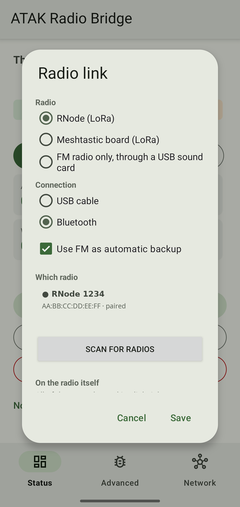
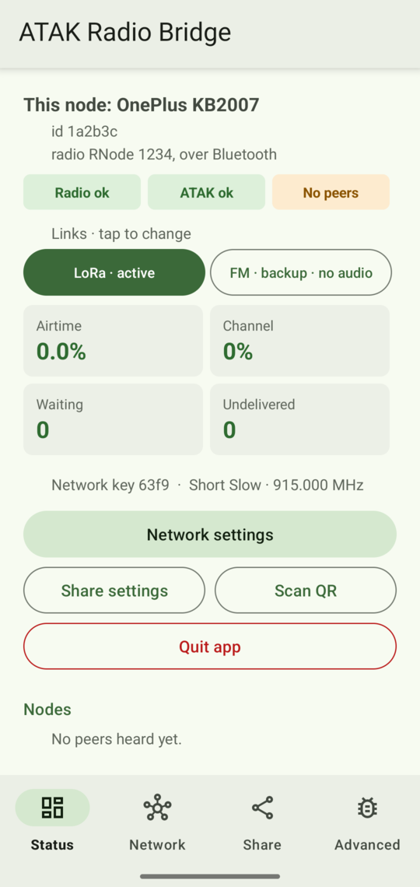
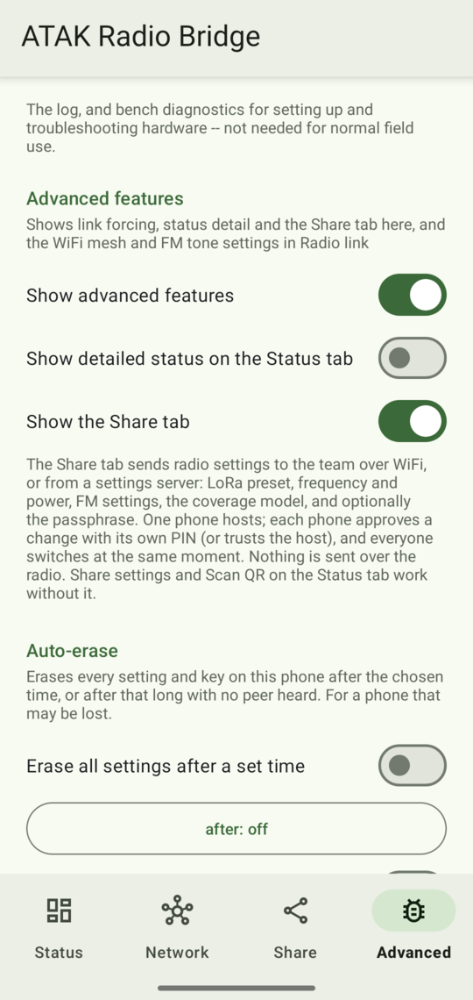
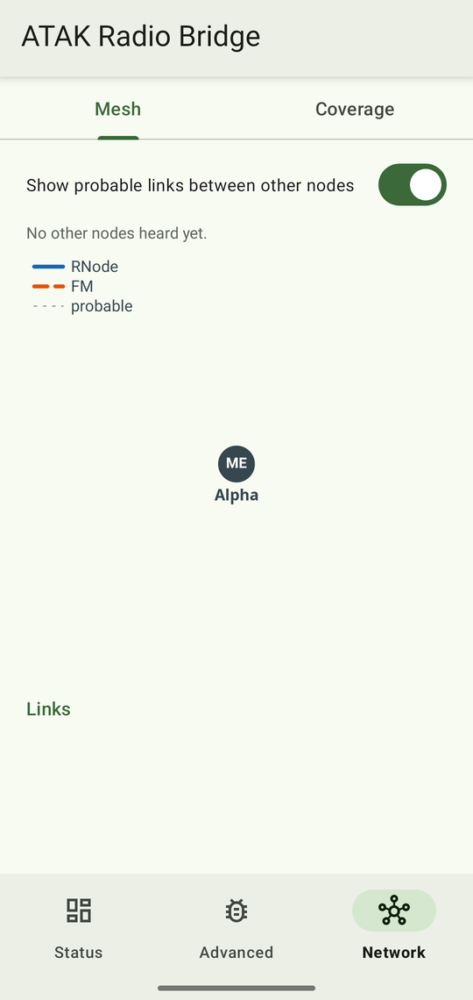
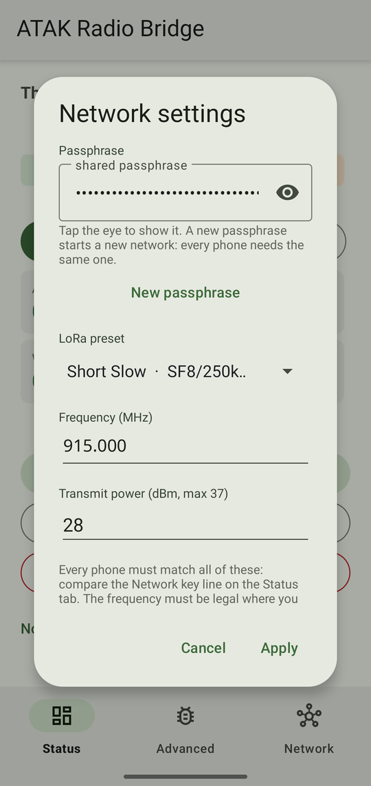
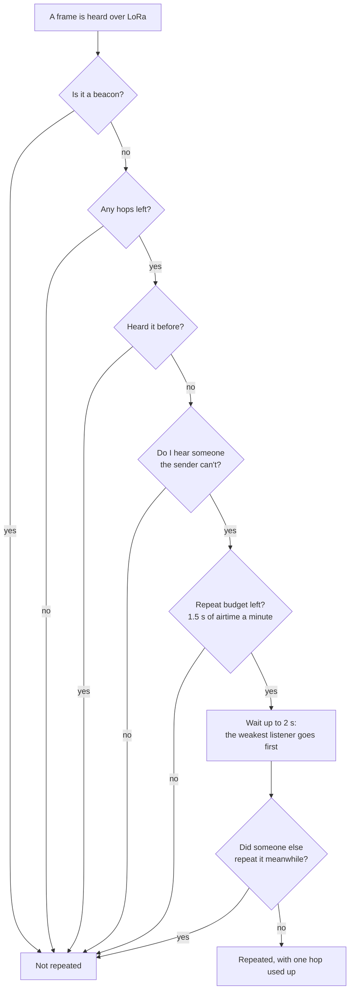
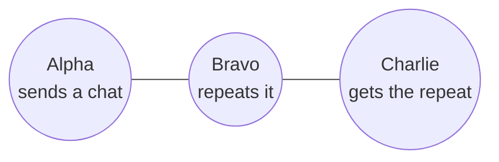
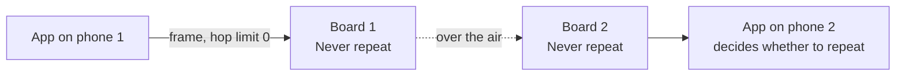

# User guide

This guide covers every screen and setting in the app, how traffic is routed
between radios, and the repeating rules for RNodes and Meshtastic boards. The
quick setup steps are in the [README](../README.md).

Where a number is given, it is the value in the source code, and the Python
module is named so you can check it. If this guide and the code ever disagree,
the code is right.

**Contents**

1. [What the app does](#1-what-the-app-does)
2. [Hardware](#2-hardware)
3. [Connecting the radio](#3-connecting-the-radio)
4. [Connecting ATAK](#4-connecting-atak)
5. [The screens](#5-the-screens)
6. [Settings dialogs](#6-settings-dialogs)
7. [What gets sent](#7-what-gets-sent)
8. [Routing: which radio carries what](#8-routing-which-radio-carries-what)
9. [Repeating rules: RNodes and Meshtastic boards](#9-repeating-rules-rnodes-and-meshtastic-boards)
10. [Delivery and retries](#10-delivery-and-retries)
11. [Sharing settings with a team](#11-sharing-settings-with-a-team)
12. [Troubleshooting](#12-troubleshooting)
13. [What has been tested](#13-what-has-been-tested)

---

## 1. What the app does

```
 ATAK ──TCP 127.0.0.1:7103──▶ the app ──▶ LoRa radio (RNode or Meshtastic board)
                                      ├──▶ FM handheld (backup, via USB sound card)
                                      └──▶ Wi-Fi (last resort)
```

- ATAK connects to the app as if it were a TAK server on the phone itself.
- The app shrinks each ATAK event (a position report goes from about 700 bytes
  of XML to about 60), encrypts it, and sends it over the best working radio.
- Events heard over the air are decrypted and handed back to ATAK as normal
  map traffic.
- The app runs as a background service. It keeps working with the screen off
  or the app closed, until you choose *Quit app*.

The app is two parts. The Kotlin part handles Android: USB, Bluetooth, the
sound card, push-to-talk and the screens. The Python part makes every
decision: encoding, encryption, routing, retries and the FM modem. The screens
only show what the Python part decided.

## 2. Hardware

| Role | Tested with | How it connects |
|---|---|---|
| LoRa radio, RNode firmware | Heltec LoRa32 v3 | USB-C OTG cable, or Bluetooth LE |
| LoRa radio, Meshtastic firmware | RAK4631, Seeed Tracker L1 (firmware 2.7.x) | USB, or Bluetooth |
| FM backup | Any FM handheld, plus a Digirig (CM108 USB sound card with a PTT pin) | USB audio; a cable with no PTT pin falls back to the radio's VOX |

**Other USB boards.** Android only offers the app USB permission for boards
listed in `app/src/main/res/xml/device_filter.xml`. Silicon Labs CP210x, the
RAK4631, the Tracker L1 and the Digirig are already listed. For any other
board, add its vendor and product id (from `lsusb`, written in decimal) and
rebuild.

## 3. Connecting the radio



Everything here lives in **Radio link**: tap any of the link buttons on the
Status tab. While the bridge isn't running, a **Radio link** button appears
there instead.

The dialog asks two questions:

- **Radio:** **RNode**, **Meshtastic board**, or **FM radio only** (an FM
  handheld through a Digirig, with no LoRa radio).
- **Connection** (for RNode or Meshtastic): **USB cable** or **Bluetooth**.

**Connecting**

- **USB cable:** plug the radio in, then accept Android's prompt. Tick
  "always open with this app", because some boards restart after a settings
  change and would otherwise wait behind a new prompt.
- **Bluetooth (RNode):** with the radio connected by cable and working, tap
  **Switch to Bluetooth** at the top of Radio link. In one go, the app:
  1. turns on the radio's Bluetooth and puts it into pairing mode,
  2. finds the radio (the strongest RNode signal, which is the one on the
     cable) and shows its name,
  3. pairs it, typing the six-digit code into Android's prompt for you,
  4. asks to restart the bridge. Tap **Restart**, then unplug the cable.

  It takes about 15 seconds. If the phone won't let the app type the code,
  the code is shown to type in by hand. The radio stays in pairing mode for
  about a minute.

  **Pairing by hand** (no cable, or two radios side by side): pick
  **Bluetooth** under Connection, tap **Scan for radios**, then tap the radio
  and **Pair**.
  - If that radio is on this phone's cable, the app puts it into pairing
    mode and fills in the code, as above.
  - Otherwise, first hold the radio's button for 5 seconds to put it into
    pairing mode, and type the code from its screen when Android asks.
  - Then tap **Save** and restart.

  Bluetooth radios don't appear in Android's own Bluetooth settings, which is
  why the scan is inside the app. Over Bluetooth the radio needs its own
  battery.
- **Meshtastic board:** Network settings then also offers **Meshtastic board
  settings…**, which opens the [Meshtastic board](#meshtastic-board) dialog.
- **FM radio only:** use a Digirig and an FM handheld. See the FM options
  below.

**Options on the same screen**

- **Use FM as automatic backup:** builds the FM link next to LoRa. FM then
  takes over if LoRa fails (see [section 8](#8-routing-which-radio-carries-what)).
- **Which radio:** with one radio paired, it is picked for you. With several,
  tap the one this phone should use; Save asks you to pick one.

**FM station ID and encryption.** This section appears whenever FM is in use.
Both settings are for licensed amateur operation, where the rules require you
to identify and forbid obscuring what you are sending.

- **Callsign** (blank = off): sent as an audible Morse tone, in the clear,
  taking about 5 s, every **10 minutes** by default. 3 to 12 letters, digits
  and `/`, with at least one digit; anything else is refused when you save.
  The first one goes out shortly after the FM link comes up, then on the
  interval. Nothing is sent while *Test mode: receive only* is on.
  - The interval can be set from 1 to 120 minutes. **US Part 97 requires
    every 10 minutes**, so the app will let you choose an interval that your
    licence does not. That is left to you on purpose; the app does not know
    where you are.
- **Send FM unencrypted:** sends FM traffic as plain text. **LoRa stays
  encrypted either way** — this changes nothing about the LoRa link. Every
  phone on the FM net has to match, because a phone with it off ignores the
  plain frames a phone with it on sends.
  - **A plain frame proves nothing about who sent it.** Encryption and
    authentication are the same step here, so turning it off also gives up
    the check that keeps strangers from putting markers on your map. On FM,
    in this mode, anyone within range can. That is the trade the amateur
    rules ask for, and it is worth being clear-eyed about.
  - It travels with shared settings like any other net-wide setting. A phone
    running a build older than this feature refuses the whole bundle and says
    to update the app.

**Advanced options.** These only appear after you turn on *Advanced → Show
advanced features*. Turning the switch off hides them again but keeps their
values.

- **Use a WiFi mesh as an additional link:** adds Wi-Fi as the last-resort
  link.
- **FM tone placement** (shown when FM is in use): *fast* (the default),
  *narrow*, *wide*, or **Custom**, which is your own tones, rate and keying,
  set in [Custom FM settings](#custom-fm-settings) via **Edit custom
  settings…**. Every radio on a net must use the same placement.
- **Cable has no PTT pin (K1 PRO / VOX radio):** keys the radio with its
  voice-operated switch instead of the PTT line.
- **Test mode: receive only, do not transmit:** for listening without keying
  the radio. While it is on, the Status tab shows a warning.
**On the radio itself** (needs a working link):

- **Identify:** flashes the light on the radio this phone is connected to.
- **Radio screen…:** puts this node on the RNode's small screen: node id,
  radio name, phone name, and who it can hear. Off by default. The same
  button gives the screen back to the radio.

The line above the link buttons says **restart to apply** while a saved
change hasn't taken effect yet.

## 4. Connecting ATAK

In ATAK, go to *Settings → Network Preferences* and add a server (streaming)
connection:

| Setting | Value |
|---|---|
| Host | `127.0.0.1` |
| Port | `7103` |
| Protocol | TCP, no SSL |

Each phone's ATAK connects only to its own copy of the app, and nothing leaves
the phone except over the radio. The port is 7103, not the usual 8087, because
ATAK's own mesh networking already uses 8087.

## 5. The screens

The app has three tabs: **Status, Network, Advanced**. Network has two sub-tabs
at the top, **Mesh** and **Coverage**, and reopens on the one you used last. A
fourth tab, **Share**, appears when you turn on *Advanced → Show advanced
features → Show the Share tab*.

### Status

The tab you use day to day.



- **Identity:** this node's id. The radio's name appears when connected over
  Bluetooth.
- **Network key line:** for example `Network key 63f9 · Short Slow · 915.000
  MHz`. The four-character key is a fingerprint of the passphrase. Everything
  on this line must be the same on every phone. A wrong passphrase and a dead
  radio look the same from one phone, so compare this line first.
- **Health line:**
  - *Radio ok* / *No radio*: the radio carrying traffic now. When FM is the
    active link, this shows FM's receive state instead (table below).
  - *ATAK ok* / *No ATAK*
  - *Mesh N* (number of connected peers) / *No peers*
- **FM receive health** (when FM is on): shown on the FM link button, for
  example *FM · backup · no audio*, and on the health line when FM is the
  active link.

  | Reading | Meaning | What to do |
  |---|---|---|
  | *Hearing* | decoding traffic | nothing |
  | *No traffic* | no one is sending; a warning, not a fault | nothing yet |
  | *Garbled* | signal arrives but won't decode | adjust the volume knob as the level readout says |
  | *Silent* | no audio at all | check the radio |
  | *No audio* | the app has no sound card to listen to | check the cable first — this usually means the USB sound card has dropped off the bus, and a bridge restart cannot bring back a device Android cannot see |
- **Link buttons:** one button per link.
  - *active* (filled): the link carrying traffic now.
  - *backup* (outlined): set up and listening, ready to take over.
  - *off* (dimmed): not set up.
  - The WiFi button only appears when Wi-Fi is on or advanced features are on.
  - Tap any of them to open **Radio link** (the line above says *Links · tap
    to change*).
  - If a link has been forced from the Advanced tab, a warning line says so.
- **Tiles:**
  - **Airtime:** this node's share of the channel. It turns amber above 10%
    and red above 25%.
  - **Channel:** how busy the channel is.
  - **Waiting:** messages queued.
  - **Undelivered:** one-shot messages that ran out of retries.
- **Messages:** appears only when a message failed, so you can't miss it.
- **Nodes:** every peer, with how many hops away it is, and signal strength
  (SNR) and loss on direct links. "Connected" means a frame from that phone
  actually crossed the air in the last three beacon intervals.
- **Buttons:**
  - [Network settings](#network-settings): passphrase, LoRa preset,
    frequency and power
  - **Share settings** (shows a QR code) / **Scan QR** ([section 11](#11-sharing-settings-with-a-team))
  - **Quit app**, which stops the service fully

### Advanced

Bench and field-test tools.



- **Advanced features:** **Show advanced features** reveals:
  - **Show the Share tab:** off by default. *Share settings* and *Scan QR* on the
    Status tab work either way. With the tab hidden, settings offers that
    arrive over Wi-Fi open as a dialog instead. Once shown, the Share tab
    stays even if you turn advanced features back off; switch it off here to
    hide it again.
  - **Show detailed status on the Status tab:** off by default. When off, the
    Status tab hides its informational lines: the build stamp, the full radio
    line, the FM net code and settings, the FM receive summary, the re-send
    counts and the **Diagnostics** section (channel noise and the position
    policy counters).
    Warnings always show, including which way to turn the volume knob.
  - **Auto-erase:** see [below](#auto-erase).
  - **Link:** **Auto** lets the app choose. **Force LoRa / Force FM / Force
    WiFi** pins one link after you confirm. Health is still measured
    underneath, so going back to *Auto* resumes cleanly. A `*` marks the
    current choice. The buttons are greyed out while only one link is set up.
  - the advanced options in [Radio link](#3-connecting-the-radio).

- **Log:**
  - **Start log / Stop log** records the app's log to a file. The phone's own
    log buffer only holds a few minutes.
  - **Export** saves the log to Downloads.
- **Link diagnostics:**
  - **Survey:** a passive band survey that ranks channels by their worst noise
    reading (`spectrum.py`). It sends nothing.
  - **Range test:** while running, beacons go out every 30 s instead of 60 s
    and carry the sender's GPS fix. Every beacon heard is logged with both
    positions, the distance, signal strength and the age of each fix. Rows
    whose fix is too old are marked unusable rather than trusted.
    **Stopping the test saves the CSV to Downloads.**
- **Audio bench** (only while FM is in use):
  - **Test tone (10 s):** plays a tone through the FM cable to check the audio
    path. It sends no mesh traffic.
- **Bridge:**
  - **Restart bridge:** stops the radio, ATAK connection and mesh, then starts
    them again. Rarely needed by hand: the app offers a restart itself
    whenever a change needs one.

#### Auto-erase

Erases every setting and key on this phone after a set time, for a phone that
may be lost or taken. Off by default, and hidden unless *Show advanced
features* is on.

Two timers, either or both:

- **Erase all settings after a set time** — a dead man's handle. It runs down
  whatever you do.
- **Erase all settings if no peer is heard after a set time** — it runs down
  only while no other node is heard, and hearing one puts it back to the start.

Turning a switch on arms it at 1 day (the first) or 1 hour (the second). The
button under each one offers 1 hour, 6 hours, 12 hours, 1 day, 2 days, 7 days
or 30 days. **There is nothing shorter than an hour**, deliberately.

Changing either timer restarts **both** countdowns.

**What a wipe takes.** The passphrase, this node's id, the radio settings, the
transmit counter, everything settings sharing keeps (your PIN, the trusted
hosts and this phone's host key), the diagnostic dumps, the logs, Reticulum's
own directory including the long-term identity it keeps there, and the app's
saved preferences — which includes **which radio this phone was paired to**.

**A wiped phone is a new phone.** It comes back with a node id it has never
used before, a passphrase it invented for itself, and the default radio
settings — so other phones list it as a new node, and giving it the team
passphrase back is *not* enough to put it on the air. Its radio has to be
chosen again in [Radio link](#3-connecting-the-radio).

**The clock.** Each timer counts seconds it has actually been running, charged
as the larger of two readings: the phone's uptime clock (which keeps counting
while the phone is asleep) and the wall clock (which covers the time the phone
was switched off). Two things follow:

- **Winding the date back does not postpone a wipe.** This was a real hole and
  was closed; setting the date back a year used to buy a year.
- **Winding the date forward can fire it early.** A timezone change or a clock
  correction counts as time passed. Early is the safe direction for a phone
  that may be lost, but it is a real cost, not a side effect nobody noticed.

**What it cannot do.** The countdown only runs while the bridge is running, so
anyone who can stop the app can stop the clock. This protects a phone that is
lost, not a phone in the hands of someone who knows what to stop.

A wipe disarms the feature, because the file holding the countdown is erased
along with everything else.

### Network → Mesh



A diagram of who is heard on which radio (`mesh_view.py`): one line per peer
per radio, marked direct or "via mesh", and graded good, weak or gone.
**Show probable links between other nodes** adds the links the app can infer
between other phones. The grading thresholds are first guesses, not measured
values.

### Network → Coverage

A predicted coverage map for your radio from where you stand (`coverage.py`).
(No screenshot here: a real map would show where the author lives.)
It uses building footprints and heights (Overture Maps, falling back to
OpenStreetMap), terrain, and your radio's power and antenna height. It is a
prediction and hasn't been checked against measured range.

- **Model…:** radio power (LoRa and FM), antenna height and other model
  inputs. **Defaults** resets them.
- **My location:** centres the map on you and recomputes from there. Coverage
  also recomputes by itself when you open the tab, pick another radio, save
  the model, long-press the map, finish a download, or move 100 m. If a
  calculation fails (for example, no internet for a new place), tap My
  location to try again.
- **Streets view / Satellite view:** switches the base map.
- **Download an area for offline use:** drag a box to download map and
  building data before going out of coverage.
  - The app shows the size and an estimate (in MB) and asks before
    downloading. **Cancel download** stops drawing the box.
  - While it downloads, the button reads **Stop download**. Stopping saves
    nothing and keeps the area you downloaded before.
  - A finished download replaces your previous downloaded area.
- **Long-press the map:** compute coverage from another point, or delete
  saved ones.
- Other nodes' coverage can be drawn from their reported positions.

### Share

Hidden unless *Show the Share tab* is on (Advanced → Advanced features).
Settings sharing between phones. See [section 11](#11-sharing-settings-with-a-team).

- **This phone as a host:** **Host settings for phones on this WiFi**.
- **Receiving:**
  - **Listen for hosts on this WiFi**
  - **Servers and hosts:** add a server by address, or scan its code.
  - **Undo the last shared change**
- **Security:** **PIN and trusted hosts** sets this phone's approval PIN and
  manages which hosts it trusts.

## 6. Settings dialogs

### Network settings

Everything every phone on the network must match, in one dialog.



- **Passphrase:** the network key. Hidden as dots; tap the eye to show it, to
  read it out or copy it to another phone.
  - **New passphrase** fills in six random words joined by dashes (about 62
    bits). Nothing changes until you tap **Apply**.
  - There is **no default**. A phone with no passphrase makes up its own and
    stays alone, rather than joining a network anyone could read.
  - If you type a passphrase of your own and it looks easy to guess (a short
    phrase of ordinary words and a year, say), tapping **Apply** asks whether
    to use it anyway. Anyone who records your radio traffic can try guesses
    against it offline, so **New passphrase** is the safer choice. This is
    only a warning; the six-word phrases never trigger it.
- **LoRa preset, Frequency, Transmit power:** as below.
- **Meshtastic board settings…** (Meshtastic radio only): opens the
  [Meshtastic board](#meshtastic-board) dialog.
- **Apply** changes only what you changed.

The radio settings in detail:

- **Preset:** eight presets, named as in Meshtastic. Every node must use the
  same one.

  | Preset | Spreading factor / bandwidth |
  |---|---|
  | Short Turbo | SF7 / 500 kHz |
  | Short Fast | SF7 / 250 kHz |
  | **Short Slow (default)** | SF8 / 250 kHz |
  | Medium Fast | SF9 / 250 kHz |
  | Medium Slow | SF10 / 250 kHz |
  | Long Fast | SF11 / 250 kHz |
  | Long Moderate | SF11 / 125 kHz |
  | Long Slow | SF12 / 125 kHz |

- **Frequency (MHz):** must match on every node, and must be one you are
  allowed to use.
- **TX power:** up to 37 dBm. If the board can't do what you ask, it reports
  the real figure, and that is what gets saved. A Heltec v3 won't go below
  13 dBm.

**Which preset?** Faster isn't automatically better. Measured on a four-node
bench:

| | Short Turbo | Short Slow | Medium Fast | Long Fast |
|---|---|---|---|---|
| Acknowledged messages per minute it keeps up with | 80 | **60** | 45 | 8 |
| Most it carries before it collapses | ~100 | **~130** | ~60 | ~10 |
| Latency floor | 0.6 s | 0.76 s | 1.0 s | 2.5 s |

Short Turbo loses to collisions while the channel is still mostly idle. Long
Fast reaches farther, but carries about eight acknowledged messages a minute
across the whole mesh.

### Meshtastic board

Opened from *Network settings → Meshtastic board settings…* when the radio is
a Meshtastic board.

- **Use the app's settings:** the recommended choice. It puts the board on the
  app's preset, frequency and power, derives the channel name and key from
  the passphrase, sets the board to never repeat, turns the board's own GPS
  off, and gives its Bluetooth a PIN derived from the passphrase. You see the
  list of changes before anything is applied.
- **Region:** a board with no region set won't transmit.
- **Preset**, **Frequency slot** (0 = automatic), and **Transmit power** (0 =
  board default).
- **Repeating other nodes' packets:**

  | Setting | Meshtastic name | Use it? |
  |---|---|---|
  | Repeat everything it hears | ALL | no |
  | Repeat only for nodes it already knows | KNOWN_ONLY | no |
  | Repeat only on this channel | LOCAL_ONLY | no |
  | **Never repeat** | NONE | **yes**; see [section 9](#9-repeating-rules-rnodes-and-meshtastic-boards) |

- **Channel name** and **Channel key** (**New random key** or **Public
  default**). The key is never displayed.
- **Share these settings with another board:** **Show link** and **Paste
  link** use Meshtastic's own share link. The link contains the channel key.
- **Review changes** shows exactly what will change before you apply it.
  "Done" means the board was read back and confirmed the change. "Sent, not
  yet confirmed" means it hasn't been read back yet.
- **Warnings** appear when the board will misbehave:
  - set to repeat
  - a repeater role
  - no region
  - transmit off
  - its own GPS on
  - Bluetooth with no PIN

### Custom FM settings

Opened with *Radio link → Edit custom settings…*.

- **Net code:** the settings every radio on the net must share, as one short
  string such as `4T-1000/400-400Bd-H1024.2048`. Type another radio's code to
  copy it.
- **Settings the whole net must share:**
  - **Tones**
  - **Symbol rate**
  - **First tone**
  - **Tone spacing**
  - **Error-correction code**
- **This radio only:**
  - **Copies per burst**
  - **Keying:** *PTT pin (Digirig)* or *VOX*
  - **De-emphasis**
- A summary shows the burst length on air and how many bytes it carries. Any
  setting that would make a burst longer than 11.5 s is refused.
- **Measure my radios…** opens the tone sweep below.

### Measure my radios

Finds which tones survive your particular pair of radios.

1. Tap **Listen** on one phone and **Send the sweep** on the other. This
   plays 33 tones from 300 to 3500 Hz.
2. The listening phone shows how loudly each tone arrived and the usable
   band.
3. It then lists settings that fit, with the measured-safe ones first.
4. **Use these settings** copies one into the custom editor for you to review
   and save.

## 7. What gets sent

**The codec** (`cot_codec.py`)

- Positions, chat, markers, shapes and routes are rebuilt from their meaning
  as packed binary, then compressed against a trained dictionary.
- After a node's first full position report, later reports carry only what
  changed.
- Anything the codec can't express goes as compressed XML, which is much
  larger.
- Messages bigger than one packet are split into up to 16 fragments.

**What the app chooses not to send** (`tx_policy.py`). ATAK sends positions
on a timer whether or not anything changed. The app sends a position only:

- after moving at least **25 m**,
- after a change of team, role or callsign, or
- when the **90 s** heartbeat is due.

Moving is capped at one report per **60 s**, except that the first move after
standing still goes at once. A 0,0 fix (GPS reacquiring) is never sent. An
event that came from the air and that ATAK echoes back isn't re-sent. Chat,
markers, drawings and routes are never throttled. On a real drive this
dropped 84% of position reports.

**Encryption** (`mesh.py`)

- Every frame is encrypted and authenticated with AES-CCM, under a key derived
  from the passphrase (PBKDF2, 200,000 rounds).
- It adds 12 bytes per frame: an 8-byte header and a 4-byte tag.
- A frame that fails authentication is dropped, so nobody without the
  passphrase can read positions or put fake markers on your map.
- Repeats of the same frame are recognised and dropped. The app remembers
  frames for 300 s, up to 512 of them.
- Beyond that, each sender has its own replay window — the last 128 counter
  values, across 4 retired counter generations — so a frame recorded off the
  air and played back hours later is still refused.
- Plain frames (see *Send FM unencrypted* in
  [section 3](#3-connecting-the-radio)) are remembered in a separate list from
  encrypted ones, so a stranger sending plain frames cannot push the record of
  real traffic out of memory.
- Each passphrase allows a limited number of app starts — 256 — before the
  phone stops transmitting, because going further would start reusing the
  numbers that keep each frame's encryption unique. The count is kept per
  passphrase, so changing to a new one starts a fresh count and changing back
  resumes the old one. See [section 12](#12-troubleshooting).

**Beacons and the peer table** (`peers.py`)

- Every node sends a small beacon every **60 s**, in its own time slot, so two
  nodes don't keep colliding.
- A beacon carries:
  - a sequence number, so losses can be counted
  - the node's name and callsign
  - on LoRa, a list of neighbours it hears directly (used for repeating,
    [section 9](#9-repeating-rules-rnodes-and-meshtastic-boards))
  - on FM, a heard-report ([section 10](#10-delivery-and-retries))
- A peer counts as connected if heard within three beacon intervals, and is
  forgotten after 600 s.

## 8. Routing: which radio carries what

**Priority:** LoRa, then FM, then Wi-Fi (`rns_bridge.py`). A link exists only
if you turned it on and its hardware is attached.

**Rules**

1. **Every link listens all the time.** Only the *active* link transmits
   beacons, positions and ordinary traffic, so nothing is sent twice on two
   radios.
2. **Failing over is instant.** If the active link becomes unhealthy, traffic
   moves at once to the next healthy link in priority order.
3. **Failing back waits 30 s.** A higher-priority link must stay healthy for
   30 s before traffic moves back, so one lucky packet can't cause flapping.
   The 30 s is a starting value, not a measured one.
4. **What "unhealthy" means:**
   - **Hard:** the radio is unplugged, disconnected or offline.
   - **Soft (LoRa and Wi-Fi):** over the last 300 s, half or more of the
     one-shot messages got **no acknowledgement at all**. At least three
     messages are needed before this counts. A busy channel doesn't count as
     unhealthy, because moving to a slower radio wouldn't help.
   - **FM** has no acknowledgements, so it counts as healthy whenever it is
     connected.
5. **Manual override** (*Force LoRa / FM / WiFi* under *Advanced → Advanced features*) beats all
   of the above until you choose *Auto* again.
6. **Per-message choices for one-shot messages:**
   - A message for a peer this phone has only ever heard on FM goes straight
     to FM.
   - If a one-shot message runs out of retries on LoRa or Wi-Fi with no
     acknowledgement, it is tried once more over FM, with the same message id
     so a late copy isn't treated as new.
7. **Staying visible after failover.** When a peer's latest beacon came over
   FM, this node also sends its own beacon on FM, so the peer that dropped to
   FM can still see it.
8. **Size limits per link** (`eligibility.py`). A frame is limited by how long
   it takes to transmit, not by its size:
   - LoRa: 2.0 s per frame.
   - FM: one burst per frame, and no splitting into fragments.
   - Wi-Fi: no time limit.
9. **Gateway between radios: not switched on.** Code to forward traffic from
   an FM-only handheld onto the LoRa mesh exists (`gateway.py`) and is tested
   on the desktop, but it isn't used yet. A phone with both radios uses them
   for its own traffic and for failover only.

## 9. Repeating rules: RNodes and Meshtastic boards

The app repeats (relays) frames itself, in the same way whether the LoRa radio
is an RNode or a Meshtastic board. The radio only puts frames on the air.
Repeating is decided in `relay.py`.

**At a glance:** every frame a node hears over LoRa goes through these
checks. Only a frame that gets "yes" all the way down is repeated.



### The app's repeating rules (LoRa)

Every node *can* repeat, but by default a frame is **not** repeated. A frame
is repeated only if it passes every test below, in order:

1. **Never a beacon.** Beacons travel 0 hops.
2. **Hops left.** The sender sets a hop budget: positions **2**, one-shot
   messages (chat, markers, drawings, routes) **3**. The maximum is 7. Each
   repeat uses one hop; at 0 the frame stops.
3. **Not a duplicate.** A frame already seen is never repeated. Hearing your
   own frame come back cancels your pending repeat of it, and counts as proof
   that a neighbour repeated it.
4. **New coverage only.** Each beacon lists the neighbours its sender hears
   directly, in an 8-byte Bloom filter. A node repeats only if it hears
   someone missing from the sender's list, meaning someone the sender
   couldn't reach. In a group standing together nobody passes this test, so
   **nothing is repeated until the group spreads out.**
   - The filter can wrongly say a neighbour is already covered. That causes a
     missed repeat, never an extra one, and the next position report fixes
     it.
   - Only neighbours heard first-hand go in the list. A node heard only
     through a repeat counts as *reachable*, not as a neighbour.
5. **Airtime budget.** Each node may spend at most **1.5 s of airtime per
   minute** on repeating, with bursts up to 2.0 s. Over budget, the frame
   isn't repeated. All fragments of a message are charged together when the
   first one is accepted, so a message is never half-repeated.
6. **Wait, then cancel.** A repeat is scheduled within a 2 s window, not sent
   at once.
   - The node that heard the original **weakest** goes **first**: SNR at or
     below −10 dB goes straight away, and at or above +10 dB waits the full
     window. A weak signal means that node is probably farthest away, so its
     repeat reaches the most new ground.
   - Up to 0.25 s of random jitter breaks ties.
   - If another node's repeat of the same frame is heard first, the pending
     one is cancelled.

**Example.** Three phones in a line: Alpha and Charlie are out of each
other's range, and Bravo is in the middle.



- Alpha's beacons list who Alpha hears: only Bravo.
- Bravo hears Charlie, and Charlie isn't on Alpha's list, so Bravo repeats
  Alpha's chat. The chat had 3 hops; Bravo's copy has 2 left.
- Charlie's only neighbour is Bravo, the phone it heard the repeat from, so
  repeating again would reach nobody new. Charlie doesn't.
- If all three stood together, everyone would hear everyone and nobody would
  repeat anything.

**Other links**

- **FM never repeats.** At FM's airtime cost, repeating would starve the
  channel.
- **Wi-Fi repeats with no airtime budget,** because it has no shared-channel
  cost.

### RNodes

An RNode has no repeating of its own. It transmits exactly what the app gives
it, and the rules above are the whole story.

### Meshtastic boards

A Meshtastic board has its own flood-repeating, which would fight the app's.
So the app turns it off from both ends:



The boards only send and receive. Repeating is the app's job, by the rules
above, exactly as with an RNode.

- **The app's own packets go out with hop limit 0,** broadcast on Meshtastic's
  private-app port (256), with Meshtastic's own acknowledgements turned off.
  The app has its own acknowledgements, and a second set would only cost
  airtime. Hop limit 0 asks other boards not to repeat.
  - Measured on three boards on one channel (firmware 2.7.15): over about
    1,000 packets, the app's packets were never seen repeated.
  - That is strong evidence, not proof: a board drops duplicates before the
    app could see them.
- **Set every board to *Never repeat*.** *Use the app's settings* does this
  for you.
  - A board left on another mode still repeats other boards' own Meshtastic
    traffic (their positions and node info, at hop limit 7). Measured: 5
    repeats in 2 minutes with none of the app's traffic on the air. That is
    wasted airtime.
  - A repeating board could also hide the "my frame came back" signal from
    rule 3.
- **Use a client role, not a repeater role.** The app warns about the ROUTER,
  ROUTER_CLIENT, REPEATER and ROUTER_LATE roles.
- **Turn the board's GPS off.** With GPS on and the app connected, a board
  sent its own position every 15 to 50 s even when set to once a day, and
  every repeating board then repeated it. On three boards that used about a
  quarter of the channel. *Use the app's settings* turns it off.
- **Channel name and key** come from the passphrase, so all of the team's
  boards end up on the same private channel.
- **The board's Bluetooth PIN** is derived from the passphrase and the board's
  node number, so a board with no screen can still be paired.
- **This is not interoperability with Meshtastic.** The app shares the radio,
  not the protocol: Meshtastic phone apps won't see ATAK traffic, and the app
  ignores ordinary Meshtastic messages. The board's receive log shows whether
  a packet arrived direct or was repeated by another board (hop start minus
  hop limit).

## 10. Delivery and retries

**Positions** are sent once and never acknowledged; the next report replaces a
lost one.

**One-shot messages** (chat, markers, drawings, routes) must be acknowledged
(`reliable.py`):

- The message is broadcast once, and each receiver sends a small
  acknowledgement.
- Up to **4 attempts**. The wait starts at 2 s or more, grows 1.5 times per
  attempt with up to 1 s of jitter, and is stretched for peers several hops
  away.
- A **direct chat** names the one node that owes the acknowledgement. Others
  still show it in ATAK, but don't answer, so one chat doesn't trigger a crowd
  of replies.
- A receiver missing some fragments says which ones it has, and the retry
  sends only the missing ones. This holds even when another node has already
  acknowledged the message: one node having it does not end the job for a node
  that is still waiting on a piece.
- Acknowledgements are spread over random 0.15 s slots, up to 1 s, so they
  don't collide. Up to 8 share one transmission.
- A repeat of a message that already arrived is acknowledged again, but not
  shown in ATAK twice.
- **Failure is loud.** A message that runs out of retries shows under
  *Messages* and in the *Undelivered* tile. ATAK's own "read" ticks aren't
  sent, to save airtime.

**On FM** there are no acknowledgements (`fm_resend.py`):

- A one-shot message is repeated blindly: up to 5 sends, the first repeat
  after 15 ± 5 s, then about every 60 s.
- Each FM beacon carries a **heard-report**: short tags for up to 3 recent
  one-shot messages that node received. When the sender sees its tag in a
  peer's beacon, it stops repeating.

**FM details**

- **Default mode:**
  - 4-tone FSK at 400 symbols per second, on 1000/1400/1800/2200 Hz.
  - LDPC error correction (codec2).
  - A 2.95 s burst carrying up to 125 bytes.
- **Keying:** the PTT pin, with a 55 ms key-up delay and a 0.10 s lead-in.
- **Listen before transmit:** if the channel is busy, the phone waits, then
  backs off a random 0 to 2 s.
- **Half duplex:** a phone can't hear while it is transmitting, which accounts
  for a large share of FM losses.

## 11. Sharing settings with a team

One phone (or a Linux server) pushes radio settings to the group, so everyone
changes at once and nobody is left on the old settings
(`settings_share.py`, `settings_net.py`).

**What can be shared**

- LoRa preset, frequency and power
- the FM settings or net code, and whether FM is sent unencrypted
- the coverage model
- optionally, the passphrase

**Ways to share**

- **QR code:** *Status → Share settings* on the phone that is set up, then choose
  what to include. *Scan QR* on the others. A QR code that includes the
  passphrase gives the network key to anyone who photographs it.
- **Over Wi-Fi:**
  1. Turn on the Share tab on each phone (see above). On the host: *Share → Host settings for phones on this WiFi*.
  2. On the others: *Share → Listen for hosts on this WiFi*, then approve the
     host.
  3. On the host: **Push settings**.
- **Settings server:** `server/` runs the same host code on Linux, with an
  admin command line and a local-only web page. Phones connect to TCP port
  47812. See [server/README.md](../server/README.md).
  - The server pushes the **LoRa settings, the coverage model and the
    passphrase only**. It cannot push the FM settings, the net code or
    *Send FM unencrypted*, although a phone can share all three. (Its
    `--fm-mhz` and `--fm-w` options are part of the coverage model — the
    power and frequency used to *predict* FM coverage — not the FM radio
    settings.)

**Safety rules**

- Every bundle is signed by the host, and a bundle whose revision is one this
  phone has already decided on is refused, so an old bundle can't be replayed
  against a phone that has acted.
  - One gap, worth knowing: while an offer is still **waiting for your PIN**,
    a recorded older bundle from the same host can take its place, and what
    you are then shown to approve is the older settings. Check the settings
    on the screen rather than assuming they are the ones you were told to
    expect.
- A phone applies a bundle only with its own **PIN**:
  - 4 to 12 digits
  - 5 wrong tries, then a 60 s lock. Five more doubles it to 120 s, and
    again to 240 s, and so on.
  - or automatically, if the phone has chosen to trust that host
- A shared passphrase is sealed to one phone's key. No other device can read
  it in transit.
- Changes are scheduled for a common moment, 2 minutes ahead by default, so
  the whole group switches together. Each phone keeps an **Undo**.
- Settings are never shared over the radio, so sharing costs no airtime.
- **A phone with no radio connected still takes the settings.** The passphrase
  needs no radio at all, and the radio settings are saved and applied to the
  radio when it next connects, so a phone whose RNode is flat or unplugged can
  still be given the team key. The screen says they were saved but not yet
  sent. A radio that is connected and *refuses* the settings is still a real
  failure and is reported as one.

## 12. Troubleshooting

| Symptom | Likely cause |
|---|---|
| The other phone never appears under Nodes | Different passphrase (compare the Network key fingerprints), or different preset or frequency. Both look exactly like a dead radio. |
| *No radio* | Cable or Bluetooth link down. Over Bluetooth with two radios paired, pick one under *Which radio*. |
| USB radio not offered permission | Board not in `device_filter.xml`. Add its ids and rebuild. |
| Meshtastic board silent | No region set, or transmit turned off. The board dialog warns about both. |
| Meshtastic board stops after a settings change | The board restarted. Tick "always open with this app" in the USB prompt. |
| *No ATAK* | ATAK server entry missing or wrong. It must be `127.0.0.1:7103`, TCP. |
| *TRANSMIT STOPPED: counter space used up* | Each passphrase can only be used for a limited number of app starts before this phone refuses to send, because sending more would weaken the encryption. The phone still receives. Set a NEW passphrase (use *New passphrase*) on every phone. The same stop appears if the phone cannot save its counter, usually full storage. |
| *Change the passphrase soon: transmit counter 240 of 256 used* | Early warning for the stop above. Set a NEW passphrase on every phone before the counter reaches 256. |
| *COUNTER FILE WAS LOST* | The phone forgot how far it had counted, so it came back with a new node id. Other phones will list it as a new node. Change the passphrase soon. |
| FM *Garbled* | Receive volume wrong. Follow the level readout. Too high is as bad as too low. |
| FM *Silent* | Radio off, squelch closed, or cable unplugged. |
| FM *No audio* | Android cannot see the USB sound card. Unplug it and plug it back in; restarting the bridge will not help, because the device is not there to open. |
| No Morse station ID goes out | No callsign set, or *Test mode: receive only* is on. |
| This phone came back as a new node, with nothing set up | [Auto-erase](#auto-erase) fired. Giving it the passphrase back is not enough: its radio has to be chosen again in *Radio link*, and its sharing PIN and trusted hosts are gone too. |
| A message under *Messages* / *Undelivered* | It got no acknowledgement after every retry. Resend, or move closer. |
| High *Airtime* | Too many nodes or too slow a preset. See the preset table in [section 6](#network-settings). |

For a field problem, use *Advanced → Start log*, reproduce the problem, then
*Export*.

## 13. What has been tested

**Measured on real radios**

- the codec
- the position policy (84% of reports dropped on a drive)
- acknowledged delivery with honest failure reporting, in both directions,
  for broadcast chat and for a chat addressed to one node
- the encrypted mesh
- Bluetooth to the RNode
- Meshtastic boards as the radio
- two phones meshing over FM, with heard-reports stopping repeats in both
  directions
- **repeating, on three nodes in a line** (2026-11-12): a frame relayed by the
  middle phone in both directions, the hop budgets spending exactly one hop
  per relay, beacons never relayed, nothing relayed at all while every node
  could hear every other, and a node reached only through the relay correctly
  counted as reachable rather than as a neighbour
- **fragmented messages**: a chat split into two packets, delivered whole, and
  relayed as fragments by the middle phone
- **auto-erase**, fired on a phone: keys, node id, radio settings, counter and
  logs all gone, and the feature disarmed itself afterwards

**Load figures** come from two to four nodes. Behaviour at sixteen nodes is
modelled, not measured.

**Range reached so far**

| Test | Link | Result |
|---|---|---|
| Bench (radios close together) | LoRa | Everything above. LoRa range at distance is **not yet tested**. |
| Walk, 2026-11-07 | FM | 69–77% of bursts delivered depending on direction, out to 298 m |
| Three drives, 2026-11-08 | FM | One way: decoded at **1384 m**. Other way: 846 m. Both ways at once: about 456 m. |

The stronger FM direction flipped between drives. A receive volume set too
high is the likely cause; that is inferred, not proven.

**Built and desktop-tested only**

- the gateway between FM and LoRa (not switched on)
- the newest frame-size savings
- FM settings sharing between two radios
- the Morse station ID and *Send FM unencrypted* — the station ID has never
  keyed a radio in a test, and unencrypted FM has been decoded by a laptop
  listener but not between two phones
- repairing a part-received message: a receiver that is missing fragments does
  report exactly which ones, and that was watched happen on the air; the
  sender's answer to it is covered by tests but has not been reproduced on
  radios since it was fixed

**Not exercised at all yet**

- markers, drawings and routes end to end — chat is the only one-shot traffic
  that has been driven through ATAK on both phones
- duplicate suppression and the retry schedule. Every message on the bench so
  far has been acknowledged on its first transmission at a few metres, so
  nothing has ever had to retry, and no duplicate has ever arrived to be
  suppressed. These need a degraded link, not another run on a desk.
- the repeating airtime budget's ceiling. The budget is charged and recovers
  as designed, but no run has come near spending it.

**First guesses, not measurements**

- the 30 s failback delay
- the Mesh sub-tab's grading thresholds
- the FM back-off

The beacon interval is temporarily 60 s; the intended value is 90 s.
